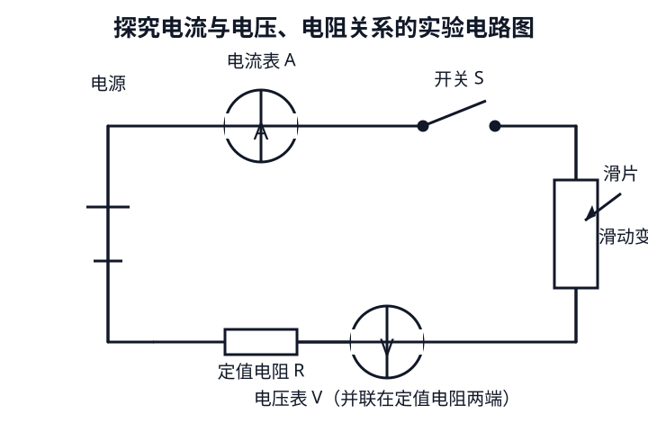
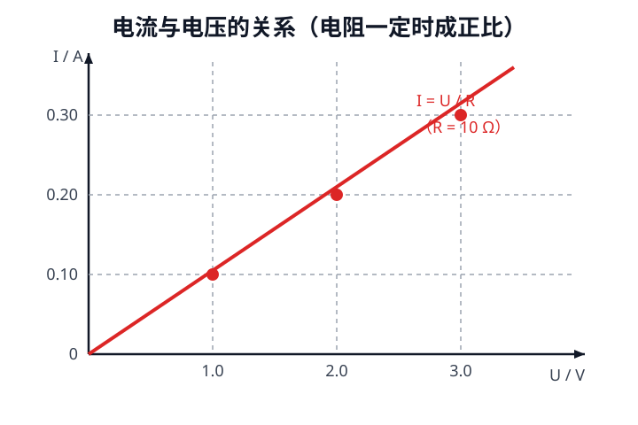
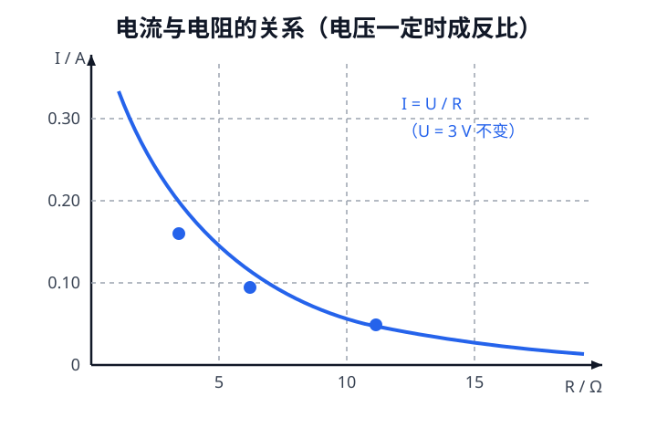

# 欧姆定律探究实验

## 一、实验目的
探究电流与电压、电阻的关系

## 二、实验器材
电源、电流表、电压表、滑动变阻器、定值电阻（5Ω/10Ω/15Ω）、开关、导线若干

## 三、实验电路图

> 接线要点：电流表**串联**在电路中，电压表**并联**在定值电阻两端；闭合开关前，滑动变阻器滑片移到阻值最大处。

## 四、实验步骤
1. 按电路图连接电路，开关保持断开
2. 保持电阻 R=10Ω 不变，调节滑动变阻器，记录不同电压下的电流值
3. 保持电压 U=3V 不变，更换不同阻值的定值电阻，记录电流值

## 五、实验数据

| 电压 U/V | 1.0 | 2.0 | 3.0 |
|---------|-----|-----|-----|
| 电流 I/A | 0.10 | 0.20 | 0.30 |

### 电流与电压的关系图像（电阻一定）

> 图线是过原点的直线，说明电阻一定时，电流与电压成正比；直线斜率等于 1/R。

### 电流与电阻的关系图像（电压一定）

> 图线是双曲线的一支，说明电压一定时，电流与电阻成反比。

## 六、实验结论
- 电阻一定时，电流与电压成正比（I ∝ U）
- 电压一定时，电流与电阻成反比（I ∝ 1/R）
- 欧姆定律公式：**I = U / R**

## 七、注意事项
- 连接电路时开关必须断开
- 闭合开关前，滑动变阻器滑片移到阻值最大处
- 电流表串联、电压表并联，注意正负接线柱不要接反
- 读数时视线与指针垂直，估读到分度值下一位
